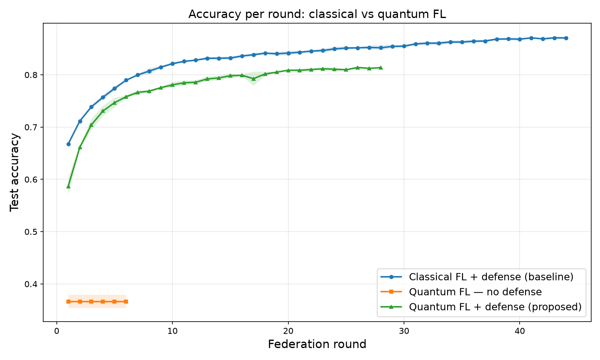
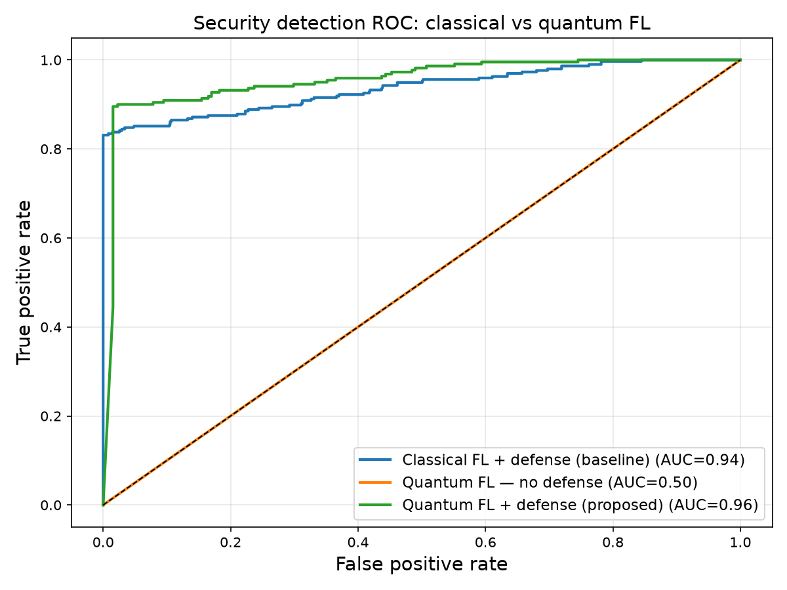
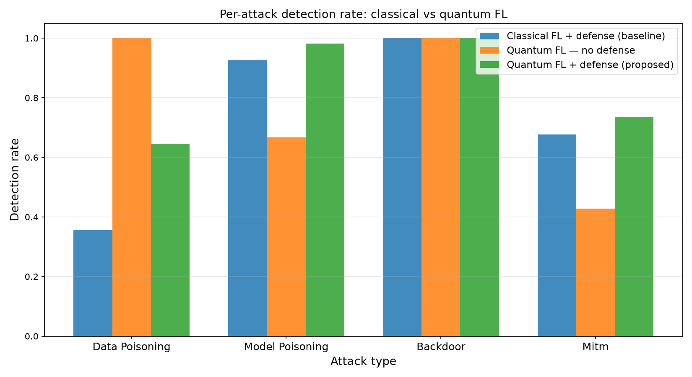
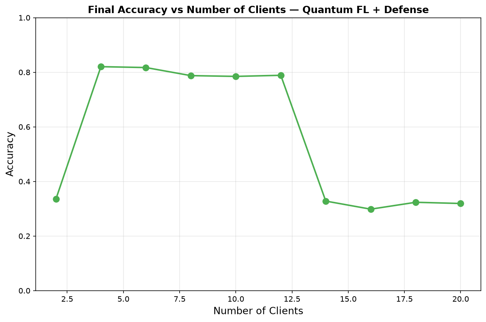

# Adversarially Robust Federated Quantum Machine Learning for Healthcare

A federated learning (FL) framework in which hospitals (clients) jointly train a **hybrid classical–quantum model** to predict liver cirrhosis stage without sharing patient data. The framework also defends against adversarial clients and network attackers.

The project asks one question: **do the adversarial defenses built for classical federated learning still protect a federated model whose clients train variational quantum circuits (VQCs)?**

This repository contains the code for the paper:

> **Adversarial Robustness in Federated Quantum Machine Learning for Healthcare: Attacks, Adaptive Defenses, and Post-Quantum Secure Aggregation**
> Abigail Abakah-Mensah, Department of Computer Science, Norfolk State University

### Key results at a glance

| | Accuracy | Detection AUC |
|---|---|---|
| Quantum FL, **no defense** | 36.0% (near chance) | 0.50 |
| Quantum FL **+ defense** (proposed) | **82.84% ± 0.75%** | **0.96** |
| Classical FL + defense (baseline) | 87.0% | 0.94 |

Without defenses, quantum FL fails to learn when 20% of clients are adversarial. With defenses, it comes within about 4 points of the classical baseline's accuracy and detects attacks slightly better (AUC 0.96 vs. 0.94). See [Results](#results) for details.

---

## Highlights

- **Hybrid VQC model.** A classical encoder feeds an 8-qubit variational quantum circuit built with [PennyLane](https://pennylane.ai), followed by a classical classification head. It is a drop-in replacement for the classical PyTorch model.
- **Four simulated attacks.** Data poisoning (label flipping), model poisoning (weight noise), backdoor (trigger injection), and man-in-the-middle tampering of encrypted updates.
- **Layered defenses** on both the client and the server (see [Defense pipeline](#defense-pipeline)).
- **Post-quantum transport security.** Client updates are encrypted using a key exchanged with **CRYSTALS-Kyber-768 (ML-KEM-768, NIST FIPS 203)**. This protects against "harvest now, decrypt later" attacks.
- **Controlled comparison.** The same pipeline runs classical FL and quantum FL, with and without defenses, and produces ten paper-ready figures.

---

## Experimental conditions

`run_quantum_experiment.py` runs three conditions, each repeated 3 times:

| # | Condition | Model | Defenses |
|---|---|---|---|
| 1 | Classical FL + defense (baseline) | `CirrhosisPredictor` (MLP) | On |
| 2 | Quantum FL, no defense | `HybridVQCPredictor` | Off |
| 3 | Quantum FL + defense (proposed) | `HybridVQCPredictor` | On |

Default settings: 10 clients, up to 50 rounds, early stopping with patience 5. In each round, every client has an 80% chance of being benign and a 5% chance of each attack type.

### Metrics

- **Accuracy:** global model accuracy on the held-out test set
- **ADR (Attack Detection Rate):** fraction of malicious clients caught
- **FPER (False-Positive Exclusion Rate):** fraction of benign clients wrongly excluded
- **Latency:** time per round, for aggregation, and for validation, plus how each scales with the number of clients

---

## Results

All numbers are means over 3 independent runs with 10 clients.

### Overall

| Condition | Accuracy | AUC | ADR | FPER |
|---|---|---|---|---|
| Classical FL + defense | 87.0% | 0.94 | 78.1% | 8.2% |
| Quantum FL, no defense | 36.0% | 0.50 | n/a | n/a |
| **Quantum FL + defense (proposed)** | **82.84% ± 0.75%** | **0.96** | **84.3%** | 11.6% |

The three runs of the proposed system reached 82.84%, 81.92%, and 83.76%. The undefended system stayed at about 36% in every round.

<p align="center">
  
  
</p>

### Detection by attack type

| Attack | Classical + defense | Quantum + defense | Per-run AUC (quantum + defense) |
|---|---|---|---|
| Backdoor | 100% | **100%** | 0.97 / 0.95 / 0.98 |
| Model poisoning | 92% | **98%** | 0.90 / 0.83 / 0.89 |
| Man-in-the-middle | 68% | **73%** | 0.83 / 0.75 / 0.78 |
| Data poisoning | 36% | **65%** | 0.83 / 0.93 / 0.82 |

<p align="center">
  
</p>

### Clinical performance

Per-stage ROC AUC averaged over the three runs: **Stage 1: 0.927**, **Stage 2: 0.910**, **Stage 3: 0.930**. Stage 2 scores slightly lower, as expected, because intermediate-stage cirrhosis overlaps with the stages on either side. The confusion matrices show no systematic bias toward any class.

### Operating window for the number of clients

Final accuracy depends strongly on how many clients take part:

| Clients | Final accuracy |
|---|---|
| 2 | ~33% (too little data per client) |
| **4–12** | **78–82%** |
| 14–20 | ~30–33% (filtering leaves too few trusted updates) |

<p align="center">
  
</p>

With this dataset size and a 20% attack rate, the system works reliably only with **4 to 12 participating hospitals**.

### Cost

- Average round time is about 700 s, mostly from Kyber-768 encryption of each parameter.
- Server aggregation takes about 50 s per round, and validation takes under 1 s.
- Round time stays roughly flat as the number of clients grows from 2 to 20.

---

## Model architecture

```
Input features (≈20 after one-hot encoding + scaling)
        │
        ▼
Classical encoder
  Linear(input_dim → 64) → ReLU → Dropout(0.2)
  Linear(64 → 8) → Tanh            (8 values in (-1, 1))
        │  × π  → rotation angles in (-π, π)
        ▼
Variational Quantum Circuit (8 qubits, default.qubit simulator)
  AngleEmbedding (RY)
  StronglyEntanglingLayers × 3     (72 trainable quantum parameters)
  Measure ⟨Z⟩ on each qubit
        │
        ▼
Classical head
  Linear(8 → 3) → Softmax          (cirrhosis stage 1 / 2 / 3)
```

The design follows the hybrid scheme of Chen & Yoo (2021). Gradients flow end to end through the PennyLane–PyTorch interface. This makes FGSM adversarial training and all the existing FL code work without changes.

---

## Defense pipeline

**Client side** ([clients_defense.py](clients_defense.py))
- Local data validation that rejects datasets with outliers or skewed labels
- Differential privacy: gradient clipping (max norm 1.0) plus Gaussian noise
- Adversarial training: FGSM examples (ε = 0.1) mixed into 50% of each batch
- Local model validation: accuracy, loss, and prediction-consistency checks before an update is sent

**Transport** ([encryption.py](encryption.py))
- Kyber-768 key encapsulation for each update, with a SHA-256-derived keystream encrypting each parameter value

**Server side** ([server_defense.py](server_defense.py))
- Anomaly scoring of decrypted updates using robust (median/MAD) z-scores, variance, and kurtosis
- Dynamic IQR-based thresholding after a warm-up period, always keeping a minimum number of clients
- Coordinate-wise trimmed-mean aggregation (30% trimmed from each end)
- Global model verification, with rollback to the best previous model if accuracy drops

---

## Repository structure

```
.
├── data/
│   └── liver_cirrhosis.csv          # dataset (25,000 rows, target column: Stage)
├── results/quantum/                 # generated figures
│
├── quantum_model.py                 # HybridVQCPredictor (classical encoder + VQC + head)
├── model.py                         # classical MLP baseline (CirrhosisPredictor)
├── federated_learning_quantum.py    # FL training loop for the VQC model
├── federated_learning.py            # FL training loop for the classical model
├── attack_simulation.py             # poisoning, backdoor, and MitM attacks
├── clients_defense.py               # client-side defenses (DP, FGSM, validation)
├── server_defense.py                # FederatedDefender: anomaly detection + robust aggregation
├── encryption.py                    # Kyber-768 (ML-KEM) update encryption
├── evaluation.py                    # accuracy and per-class metrics
├── performance.py                   # latency, scalability, and security metric tracking
├── data_preprocessing.py            # cleaning, encoding, scaling, client partitioning
│
├── run_quantum_experiment.py        # main entry point: all 3 conditions + all figures
├── experiments.py / main.py         # original classical-only experiment scripts
├── check_setup.py                   # environment sanity check
└── requirements.txt
```

---

## Getting started

### Requirements

- Python 3.10 or newer
- CPU only (quantum circuits are simulated; no GPU or quantum hardware needed)

### Installation

```bash
git clone https://github.com/AbigailNoelyne/Adversarially-Robust-Federated-Quantum-ML-for-Healthcare.git
cd Adversarially-Robust-Federated-Quantum-ML-for-Healthcare

python -m venv .venv
source .venv/bin/activate        # Windows: .venv\Scripts\activate

pip install -r requirements.txt
pip install kyber-py             # optional, for real Kyber-768 encryption
```

If `kyber-py` is not installed, `encryption.py` prints a warning and uses a noise-based encryption simulator instead.

### Check the setup

```bash
python check_setup.py     # checks library versions and runs a small VQC with a backward pass
python quantum_model.py   # self-test for HybridVQCPredictor
```

### Run the experiments

```bash
python run_quantum_experiment.py

# macOS: keep the machine awake during long runs
caffeinate -i python run_quantum_experiment.py
```

To do a quick smoke test first, set `NUM_RUNS = 1` and lower `MAX_ROUNDS` at the top of `run_quantum_experiment.py`.

### Expected runtime (laptop CPU)

| Step | Approx. time |
|---|---|
| One client, full local training (30 epochs) | ~12 s |
| One FL round (10 clients) | ~2 min |
| One full experiment with early stopping | ~35–40 min |
| All 3 conditions × 3 runs, plus scalability sweeps | ~6–7 hours |

---

## Outputs

All figures are written to `results/quantum/`:

| Figure | File |
|---|---|
| Accuracy per round, all conditions | `accuracy_comparison.png` |
| Security-detection ROC, all conditions | `roc_comparison.png` |
| Detection rate for each attack type | `attack_detection_bar.png` |
| Confusion matrix (one per run) | `confusion_matrix_run{N}.png` |
| ROC for each cirrhosis stage (one per run) | `roc_curves_run{N}.png` |
| ROC for each attack type (one per run) | `attack_detection_roc_run{N}.png` |
| Accuracy across rounds, all runs | `accuracy_per_run.png` |
| Latency breakdown | `performance_metrics.png` |
| Latency vs. number of clients | `scalability_metrics.png` |
| Final accuracy vs. number of clients | `accuracy_vs_clients.png` |

A summary table (accuracy ± std, ADR, FPER, round latency for each condition) is also printed to the console.

---

## Dataset

`data/liver_cirrhosis.csv` contains 25,000 patient records with 18 clinical features (e.g., bilirubin, albumin, copper, prothrombin time, ascites, edema), plus treatment and demographic fields. The target is histologic **Stage** (1–3). Preprocessing drops missing rows, one-hot encodes categorical fields, standardizes features, and holds out 10% for testing. The training set is then split evenly across clients.

---

## References

1. Chen, S. Y.-C.; Yoo, S. *Federated Quantum Machine Learning.* Entropy 2021, 23, 460.
2. Bergholm, V. et al. *PennyLane: Automatic differentiation of hybrid quantum-classical computations.* arXiv:1811.04968, 2018.
3. NIST. *FIPS 203: Module-Lattice-Based Key-Encapsulation Mechanism Standard (ML-KEM).* 2024.

---

## Citation

If you use this code, please cite:

```bibtex
@article{abakahmensah_fqml_adversarial,
  title  = {Adversarial Robustness in Federated Quantum Machine Learning for Healthcare:
            Attacks, Adaptive Defenses, and Post-Quantum Secure Aggregation},
  author = {Abakah-Mensah, Abigail},
  note   = {Department of Computer Science, Norfolk State University}
}
```

## Author

**Abigail Abakah-Mensah**, Norfolk State University ([GitHub](https://github.com/AbigailNoelyne))
